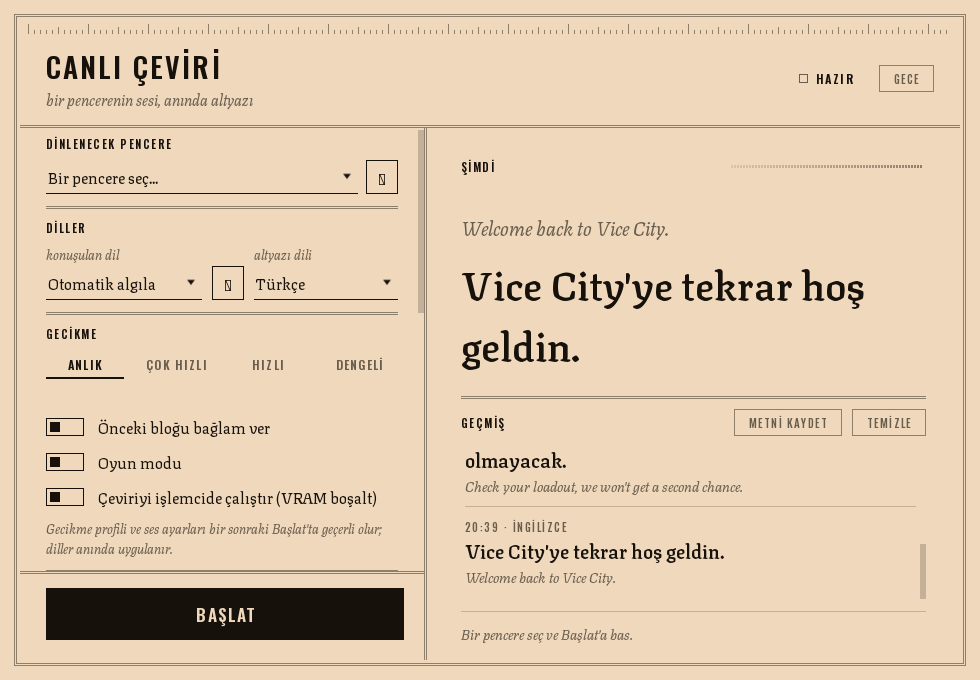
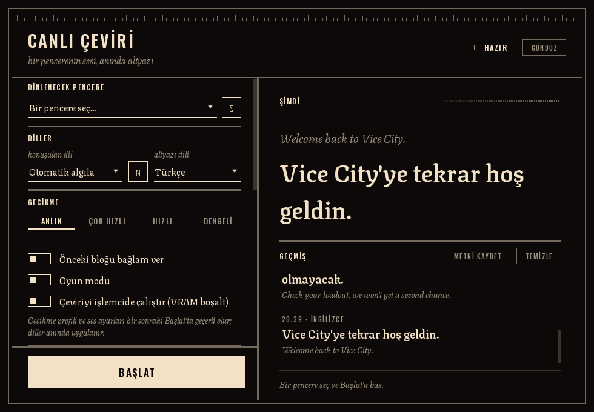
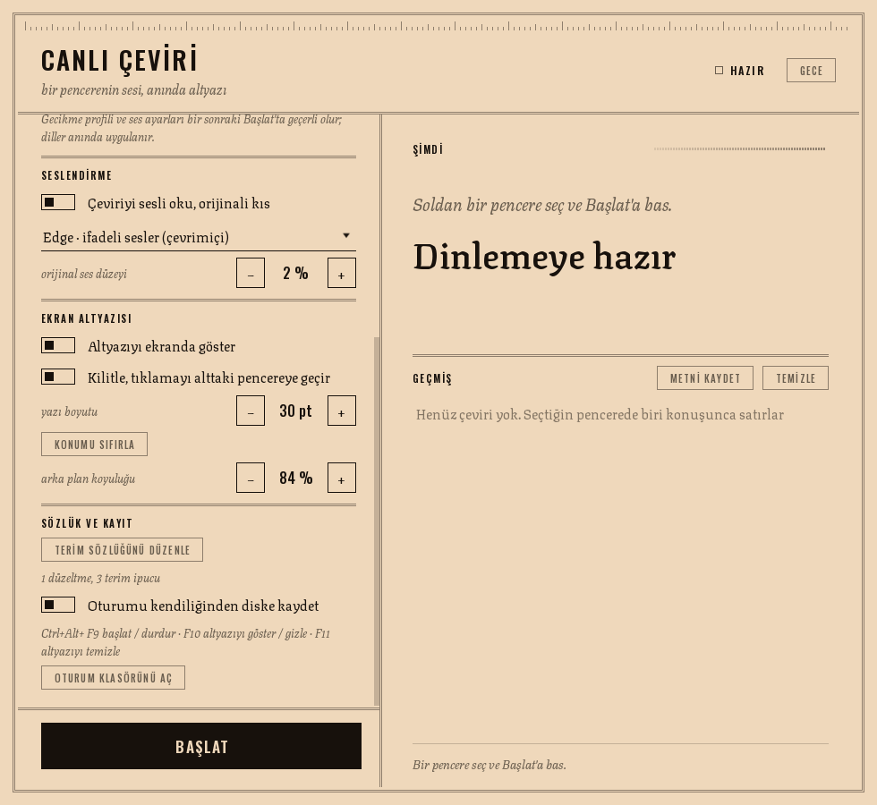
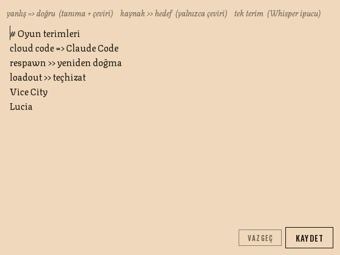

# Canlı Çeviri

Seçilen bir pencerenin sesini dinler, konuşmayı yazıya döker, seçtiğin dile çevirir; altyazı olarak üst katmanda gösterir ve istenirse sesli okur (dublaj).

## Ekran görüntüleri

Görüntüler uygulamanın kendi arayüzünden alındı; metinler örnek cümlelerdir (canlı ses yakalama değil).









## Kurulum ve çalıştırma
- Kök klasör (venv, modeller, ses dosyaları): `CANLI_CEVIRI_KOK` ortam değişkeni → yoksa `D:\CanliCeviri` → o da yoksa `%LOCALAPPDATA%\CanliCeviri`. Tüm yollar `yollar.py` içinde.
- Çalıştır: `CanliCeviri.bat` (ya da `<kök>\venv\Scripts\python.exe canli_ceviri.py`).
- İlk çalıştırmada Whisper large-v3-turbo + NLLB-200 1.3B (~3 GB) indirilir. GPU (NVIDIA, CUDA) gerekir.
- Bağımlılıklar: `requirements.txt`.

## Exe
`D:\CanliCeviri\venv\Scripts\python.exe exe_derle.py` klasör halinde `<kök>\exe\CanliCeviri\CanliCeviri.exe` üretir (~2,5 GB, CUDA kütüphaneleri dahil) ve masaüstüne kısayol koyar. Modeller pakete girmez, exe onları `<kök>\hf` altında arar. Derlenmiş exe'yi arayüz açmadan sınamak için `CanliCeviri.exe --oto-test` (sonuç `%TEMP%\canliceviri_oto_test.txt`; GPU'ya modelleri yükler).

## Kullanım
1. Pencereyi seç (sesi çalanlar `[ses var]` ile üstte) → **Başlat**.
2. **Konuşulan dil** / **Altyazı dili** dinleme sürerken de değiştirilebilir (Durdur/Başlat gerekmez).
3. Altyazı katmanını taşımak için "Kilitle"yi kaldır, sürükle, tekrar kilitle.
4. **Seslendir**: orijinal sesi kısar, çeviriyi okur. Motorlar: Edge İFADELİ / STANDART (çevrimiçi, metin Microsoft'a gider; konuşmacının cinsiyetine göre kadın/erkek ses seçer) ya da yerel Piper (çevrimdışı, tek erkek ses).
5. **Gecikme profili**: Anlık (konuşma sürerken kelime kelime), Çok hızlı, Hızlı, Dengeli. Profil ve ses ayarları bir sonraki Başlat'ta geçerli olur. Konuşmacı ayrımı ve cinsiyet tahmini tüm profillerde çalışır (Anlık'ta çevrilip gönderilen kelime bloğunun sesi üzerinden).
6. **Çeviriye önceki bloğu bağlam ver** (Anlık kip, varsayılan kapalı): önceki bloğun çevirisini sabit tutup yeni bloğu devamı olarak çevirir. 4 örnek cümlede 3'ünde sade çeviriden daha tutarlı çıktı, blok başına ~0,1 sn yavaşlatır; beğenmezsen kapalı bırak.
7. **Metni kaydet**: `.txt`, `.srt` veya `.vtt` (uzantıyı yazman yeter). Altyazı zamanları, geçmiş temizlendiğinden / program açıldığından itibaren sayılır.
8. Dinlenen pencere kapanırsa dinleme kendiliğinden durur.
9. **Terim sözlüğü** (Sözlük ve kayıt): `yanlış => doğru` tanıma hatasını düzeltir ve çeviride de uygular; `kaynak >> hedef` yalnızca çeviri çıktısında değiştirir; tek başına yazılan terim Whisper'a ipucu (hotwords) olur. Kelime sınırına bakar ("art" → "party" bozulmaz). Dosya: `%APPDATA%\CanliCeviri\sozluk.txt`, çalışırken de uygulanır.
10. **Oturumu kendiliğinden diske kaydet** (varsayılan KAPALI): her satır `%APPDATA%\CanliCeviri\oturumlar\` altına eklenir, en son 40 oturum tutulur; çökmede metin kaybolmaz.
11. **Arka plan koyuluğu**: altyazı çubuğunun saydamlığı (%10–100).
12. **Oyun modu** (Gecikme bölümü, varsayılan kapalı): programın işlemci önceliğini düşürür, konuşma algısını daha seçici yapar (müzik/efekt sahte altyazı üretmesin). Gerçek oyun sesiyle ölçülmedi.
13. **Çeviriyi işlemcide çalıştır** (Gecikme bölümü, varsayılan kapalı): NLLB ekran kartı yerine CPU'da (int8, 4 iş parçacığı) çalışır; RTX 4070'te toplam VRAM 4,2 → 2,4 GB, cümle başına çeviri 0,20 → 0,35 sn ölçüldü. Whisper GPU'da kalır. Sonraki Başlat'ta geçerli.
14. **Genel kısayollar** (oyun tam ekrandayken): Ctrl+Alt+F9 başlat/durdur, Ctrl+Alt+F10 altyazıyı göster/gizle, Ctrl+Alt+F11 temizle. Oyuna kanca takmaz, yalnızca `RegisterHotKey`.

## Dosyalar
- `canli_ceviri.py` arayüz · `ceviri_motoru.py` yakalama + VAD + Whisper + NLLB · `seslendirme.py` TTS (Edge/Piper/klon)
- `edge_ses.py` Edge sesleri · `konusmaci_ayirici.py` kim konuşuyor · `ses_cinsiyeti.py` perdeden cinsiyet
- `sozluk.py` terim sözlüğü · `oturum_kaydi.py` otomatik oturum kaydı
- `ses_kisici.py` hedef uygulamanın sesini kısma (çökmeye dayanıklı geri yükleme) · `altyazi_dosyasi.py` txt/srt/vtt · `yollar.py` yollar · `gunluk.py` kayıt (`%APPDATA%\CanliCeviri\kayit.log`)
- `klon_tts.py`, `klon_sunucu.py` XTTS klon ses (arayüze bağlı değil) · `deneme_*.py` elle çalıştırılan denemeler

## Görünüm
Matbaa/gravür dili: kâğıt-mürekkep (gündüz) ve gece teması, Texturina + Oswald, çift çizgili ayraçlar; kart/gölge/degrade yok. Sağ üstteki düğme daire perdeyle gündüz/gece değiştirir ve seçimi hatırlar. Kod `arayuz.py` içinde, fontlar `fonts\` altında (SIL OFL 1.1, `fonts\OFL-bildirim.txt`). Eski koyu arayüz `yedek_arayuz_v1_koyu\` altında.

## Testler
```
python -m unittest discover -s testler -v
```
Model, GPU, ses aygıtı ve pencere gerektirmez (sahte VAD/Whisper ile akışlı konuşmacı yolu dahil).

## Sınırlar
- Oyun: altyazı katmanı yalnızca oyun kenarlıksız pencere (borderless) kipindeyken üstte görünür; özel (exclusive) tam ekranda görünmez.
- Oyun: modeller 8 GB'lık RTX 4070'te ~4,1 GB VRAM tutar (Whisper + NLLB); oyun daha fazlasını isterse 'Çeviriyi işlemcide çalıştır' bunu ~2,3 GB'a indirir.
- Mağaza (UWP) uygulamalarının sesi yakalanamayabilir; tarayıcılarda tüm sekmelerin sesi birlikte gelir.
- Akışlı kipte tampon kırpma ölçüldü (RTX 4070): Whisper 2 sn tamponda 281 ms, 10 sn'de 325 ms; maliyet tampona neredeyse bağlı olmadığından `kirp_sn` değiştirilmedi.
- Anlık kipte konuşmacı/cinsiyet kararı ~4–7 kelimelik bloktan verilir; çok kısa bloklarda (<1,2 sn) önceki konuşmacı varsayılır. Gerçek videolarla ölçülmedi.
